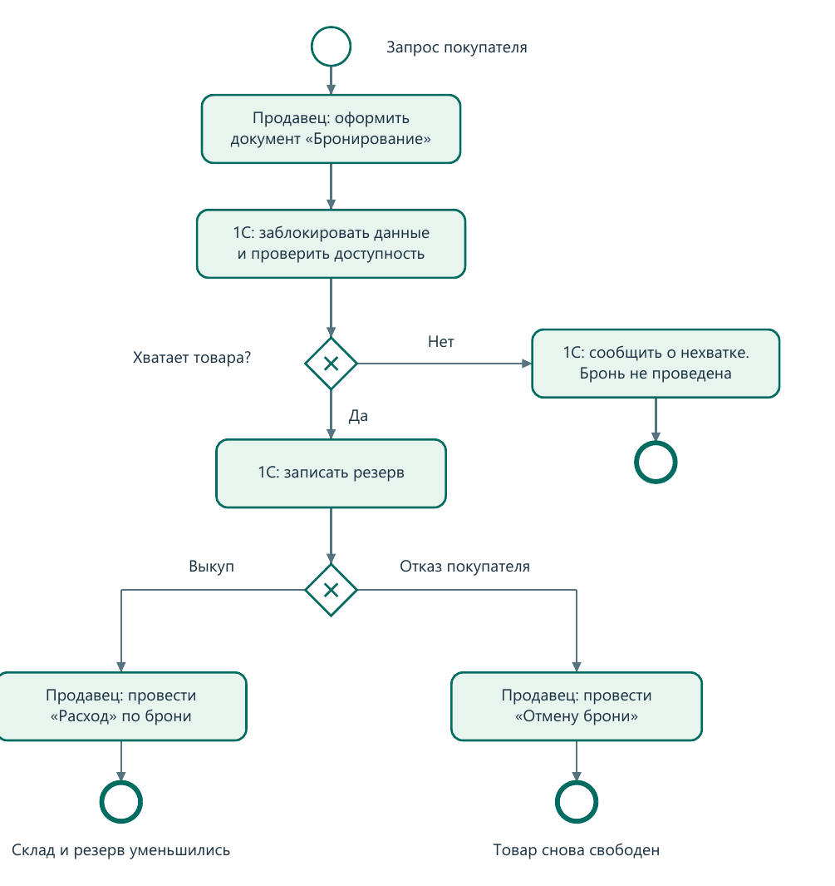
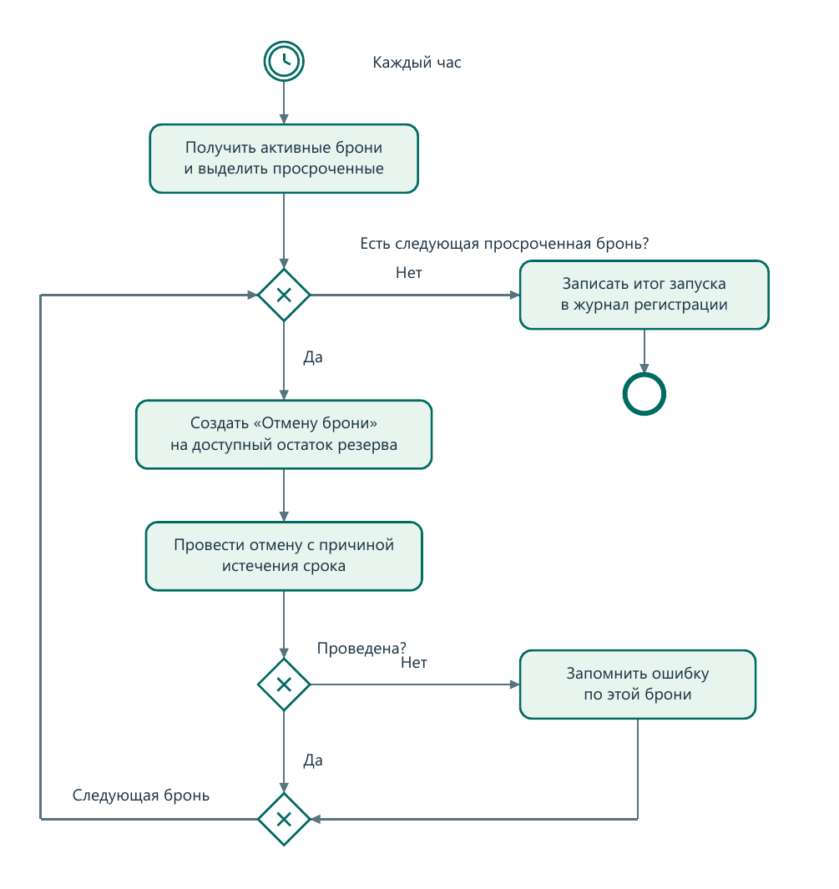

[Главная страница](/) · [Задачи команды](/projects/voltmarket/issues?set_filter=1&status_id=*)

## Оформление, выкуп и отмена брони

**Начало** — покупатель просит отложить товар. **Участники** — продавец и учётная система. Свободное количество равно остатку на складе за вычетом резерва.

Продавец указывает покупателя, товар, количество и срок. При проведении документа 1С блокирует данные по выбранному товару и проверяет свободный остаток. Если количества достаточно, товар переходит в резерв. При выкупе уменьшаются и складской остаток, и резерв. При отмене складской остаток сохраняется, а товар снова доступен другим покупателям.

## Автоматическое снятие просроченной брони

**Начало** — наступает время очередного запуска регламентного задания. **Исполнитель** — учётная система. Признак просрочки — дата окончания брони раньше текущего дня.

Раз в час 1С проверяет сроки активных броней. Если срок истёк, система создаёт документ «Отмена брони» на оставшееся количество. Например, если из двух единиц одну уже отменил продавец, автоматически снимается только вторая.

После обработки списка система записывает результат в журнал регистрации. Если проведение отдельной отмены завершилось ошибкой, система фиксирует её и продолжает обработку остальных броней.

Обе схемы составлены в **BPMN 2.0**. Круг обозначает событие, скруглённый прямоугольник — действие, ромб с крестом — выбор одной ветви. Стрелки задают порядок выполнения.

### Проверка реализации

ВМ-01 проверяет, что второй покупатель получает последний ноутбук после отмены первой брони. ВМ-02 проверяет сочетание ручной и автоматической отмены. [Задачи команды и результаты испытаний](/projects/voltmarket/issues?set_filter=1&status_id=*).
